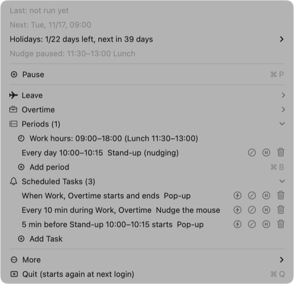
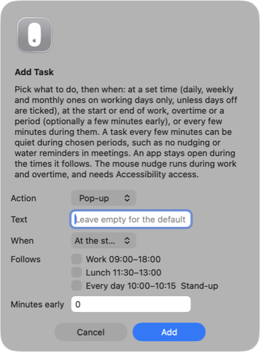

# Shiftbell

A small macOS menu bar app that runs scheduled tasks around your work time: pop-ups, opening and quitting apps, shortcuts, links and shell commands. One kind of task nudges the mouse pointer by one pixel every few minutes during work hours, so the Mac and chat apps don't mark you as away.

[中文说明](README.zh-CN.md)

## Using it

Everything is in the menu bar menu. Each leave, overtime, period and task row has buttons on the right: test (⚡, tasks only), edit (pencil), turn off without deleting (pause) and delete (bin).



- **Work hours** are the fixed first row under Periods, on working days (Monday–Friday), default 09:00–18:00. Lunch, default 12:00–13:00, sits inside them and can be unticked. Lunch is not work time: the mouse nudge and tasks every few minutes stop during it. A night shift such as 22:00–06:00 belongs to the day it starts on.
- **Periods** are named stretches of time, such as a meeting or focus time: daily, weekly, monthly or one-off. A period only gives the time a name and a countdown; tasks can run at its start or end, or pause in it. Periods apply on working days and days with overtime, a one-off period on its own date. They never add work time; overtime does that.
- **Overtime** (one day, several days in a row, or repeating) and **leave** (whole days or part of a day). Repeating overtime also runs on weekends but skips holidays. Leave wins: during leave there is no nudging, overtime does not count, and tasks wait, except timed tasks set to run on days off and one-off ones.
- **Holidays** come from any iCalendar subscription (`.ics` or `webcal://`, for example from Apple Calendar or officeholidays.com), under **More → Subscribe to Holiday Calendar**. Until you add one, only weekends are days off. See [Holiday calendars](#holiday-calendars) for where to get one.
- Monthly repeats go by weekday (1st to 5th or last) or by date (a day of the month, the last day, or N days from the end), for overtime, periods and tasks alike.

### Scheduled tasks

A task is an action and when it runs. The form only shows the fields that the chosen action and timing need.



- **Actions:** a pop-up, opening (and quitting) an app, running a shortcut, opening a link, running a shell command (in your login shell), or nudging the mouse.
- **When:** at a set time (daily, weekly, monthly or one-off; repeating ones on working days only unless **Also on days off** is ticked), at the start or end of what it follows (optionally a few minutes early), or every few minutes during it.
- **Follows:** tick any of Work, Lunch, Overtime and your periods. Each shows its time. Overtime is listed only once some is set. Nothing is ticked for a new task, and a task needs at least one. With both Work and Overtime ticked, work running into overtime tells you overtime is starting, and the end-of-work pop-up comes when the overtime ends.
- **Quiet during:** a task every few minutes can pause in chosen periods, such as no water reminders in meetings.
- An **app** task keeps the app open during the times it follows. It opens a set number of minutes before and quits a set number of minutes after (both default 0), or is only opened and never quit.
- The **Test** button (⚡) runs a task once right away, to check it is set up right.
- A fresh install has one task: **When Work, Overtime starts and ends: Pop-up**.

### The mouse nudge

The nudge is a task you add when you want it (**Add Task → Nudge the mouse**). Every N minutes (default 10) during work hours and overtime it moves the pointer by one pixel and back, so the Mac and chat apps don't mark you as away. It skips a turn when you used the keyboard or mouse in the last minute, and while the screen is locked (this can be turned on). It needs Accessibility access, and only asks for it while the task is on. The period list marks each period as nudging or not.

### Deleting a period

A deleted period is taken off every task that follows it. If a task followed only that period, Shiftbell asks what to do with it:

- **Delete with tasks** deletes those tasks too.
- **Delete period, keep tasks** keeps them, marked "won't run until given a time". Edit one and pick another period or a set time to make it run again.

A one-off period is removed on its own once it is over, together with the tasks that followed only it.

### Holiday calendars

Any `.ics` or `webcal://` link works. Shiftbell counts **every event in it as a day off**, except events that say they are not a public holiday (as Apple's do) and Ramadan, so pick a calendar that lists only days off. Some places to get one:

| Source | Example link | Notes |
| --- | --- | --- |
| [Office Holidays](https://www.officeholidays.com) | `https://www.officeholidays.com/ics/malaysia/kuala-lumpur` | Public holidays only, by country and often by state. The safest choice. |
| Apple (iCloud) | `https://calendars.icloud.com/holidays/my_en.ics` | `<country>_<language>`, such as `us_en`, `sg_en`, `jp_ja`. The same calendars Apple Calendar offers. The China one (`cn_zh`) also lists solar terms and festivals that are workdays. |
| [Thunderbird](https://www.thunderbird.net/calendar/holidays/) | `https://www.thunderbird.net/media/caldata/autogen/MalaysiaHolidays.ics` | Many countries; the page lists the links. |
| [CalendarLabs](https://www.calendarlabs.com/ical-calendar/holidays/) | `https://www.calendarlabs.com/ical-calendar/ics/42/Malaysia_Holidays.ics` | Many countries. |
| Google Calendar | `https://calendar.google.com/calendar/ical/en.malaysia%23holiday%40group.v.calendar.google.com/public/basic.ics` | Swap `malaysia` for another country, `en` for a language. Also lists observances that are workdays, such as Valentine's Day, which Shiftbell would take as days off. |
| [china-holiday-calender](https://github.com/lanceliao/china-holiday-calender) (mainland China) | `https://www.shuyz.com/githubfiles/china-holiday-calender/master/holidayCal-HO.ics` | Official days off, including the swapped ones. Use the `-HO` file: the plain `holidayCal.ics` also lists the make-up workdays (补班), which would be counted as days off. |

Shiftbell has no make-up workdays, so a weekend that is a working day in China still counts as a day off. Add overtime for it.

You can also subscribe to a company calendar if it publishes one, as long as it holds only days off.

### Other

- No clock in the menu bar: the 🖱 icon fills from the top down as the next nudge comes closer (faded off hours and while paused); with the nudge off it fills as the work stretch goes by. A countdown appears only in the 10 minutes before a named period, a period the nudge pauses in, or a timed pop-up.
- **Pause** holds the nudge and every task. On resume, and on waking from sleep or starting again, one pop-up lists today's timed pop-ups that came due meanwhile. Missed starts and ends, pop-ups every few minutes and earlier days are left out; missed shortcuts, links and commands are not run later, only noted in the log.
- A run log, cleared every quarter by default or by hand.
- Interface in English, 简体中文, 繁體中文, 日本語, 한국어, Bahasa Melayu, Español, Français and Deutsch. You can add your own language file from the Language menu.
- Optional start at login (**More → Open at login, reopen after crash**); while it is on, Shiftbell also reopens itself within about 10 seconds if it crashes (Quit does not).

Requires macOS 13 or later. Runs on Apple silicon and Intel.

Please use it in line with your workplace's policies.

## Install

### From the disk image

1. Download `Shiftbell-<version>.dmg` from [Releases](https://github.com/DailyUtility/MouseNudge/releases) and drag Shiftbell to Applications.
2. The app is not notarized by Apple, so the first launch shows an "unidentified developer" or "can't be checked" warning. Either:
   - right-click Shiftbell in Applications and choose **Open**, then **Open** again, or
   - open it once, then go to **System Settings → Privacy & Security** and click **Open Anyway**.
3. To use the mouse nudge, add it under **Scheduled Tasks** (**Add Task**, action **Nudge the mouse**), then grant Accessibility permission when asked (**System Settings → Privacy & Security → Accessibility**, turn on Shiftbell). Moving the pointer needs it. The menu shows a warning until it is granted.
4. To start it at login, tick **More → Open at login, reopen after crash** in the menu.

### From source

Needs the Xcode Command Line Tools (`xcode-select --install`).

```sh
git clone https://github.com/DailyUtility/MouseNudge.git
cd MouseNudge
./build.sh --install      # builds build/Shiftbell.app, copies it to /Applications and starts it
```

| Command | What it does |
| --- | --- |
| `./build.sh` | Builds `build/Shiftbell.app` for this Mac |
| `./build.sh --install` | Also replaces `/Applications/Shiftbell.app` and restarts it |
| `./make-dmg.sh` | Builds `build/Shiftbell-<version>.dmg` (Apple silicon + Intel), named after the version in `Resources/Info.plist` |
| `./tests/run.sh` | Runs the schedule tests |

The app icon is drawn at build time from the Mac's own Mouse settings icon, so no Apple artwork is stored in this repository.

**Signing.** macOS ties the Accessibility grant to the app's signature. The build is signed ad hoc by default, which means you have to grant Accessibility again after every rebuild. To avoid that, create a self-signed code signing certificate named `Shiftbell Local Signing` (or the older `MouseNudge Local Signing`) in Keychain Access (**Certificate Assistant → Create a Certificate**, type **Code Signing**). `build.sh` uses it when it exists. Set `SIGN_IDENTITY` to use another identity.

### Releases

Pushing a tag that matches the version in `Resources/Info.plist` (for example `v1.0.1`) makes GitHub Actions run the tests, build the disk image and publish it as a release (`.github/workflows/release.yml`). To give every release the same signature, so people keep their Accessibility grant when they update, export the signing certificate with its private key as a `.p12` file and add it as the repository secrets `SIGNING_CERT_P12` (the file, base64 encoded) and `SIGNING_CERT_P12_PASSWORD`. Without them releases are signed ad hoc.

## Privacy

Shiftbell makes no network requests except fetching the holiday calendar you set. It sends nothing anywhere.

Its data stays on your Mac, in `~/Library/Application Support/shiftbell/`:

| File | Contents |
| --- | --- |
| `holidays.json` | Cached holidays |
| `leave.json`, `overtime.json`, `periods.json` | Your leave, overtime and periods |
| `tasks.json` | Your scheduled tasks, the mouse nudge included |
| `nudge.log` | Run log |
| `languages/` | Your own language files |

Settings are in the app's preferences (`defaults read io.github.mar-er.shiftbell`).

## Translations

`Sources/Strings.swift` is the translation table. The code looks text up by short dotted keys such as `T("menu.subscribeHoliday")`, grouped by where the text appears (`menu.`, `status.`, `log.`, `confirm.`, `common.` and so on). Missing text falls back to English.

To add or change strings, write one row per key with ten columns separated by ` | ` (key | zh-Hans | en | zh-Hant | ja | ko | ms | es | fr | de), for example

```text
menu.more | 更多 | More | 更多 | その他 | 더 보기 | Lagi | Más | Plus | Mehr
```

then run:

```sh
python3 -I tools/strings.py Sources/Strings.swift rows.txt
```

A row whose key already exists replaces it. Running the tool without a rows file just rewrites the table, which checks its format.

## License

[GPL-3.0-or-later](LICENSE). You may use, change and share it. If you distribute it or a modified version, you must share the source under the same license.
