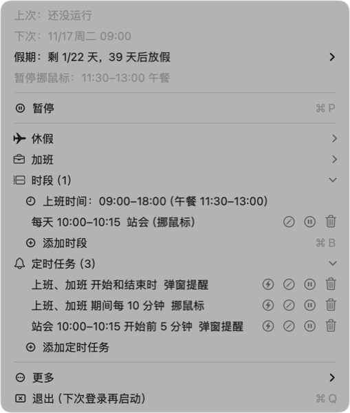
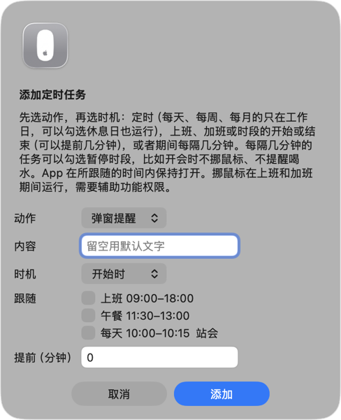

# Shiftbell

Shiftbell 是一个 macOS 菜单栏小工具，围绕上班时间运行定时任务：弹窗提醒、自动开关 App、运行快捷指令、打开链接和运行命令。其中一种任务是挪鼠标：上班时间里每隔几分钟把鼠标移动 1 像素再移回来，这样电脑和聊天软件就不会把你显示为"离开"。

[English](README.md)

## 使用

所有操作都在菜单栏的菜单里。休假、加班、时段和定时任务的每一行右边都有按钮：测试（⚡，只有定时任务有）、编辑（铅笔）、停用但不删除（暂停）和删除（垃圾桶）。



- **上班时间**是「时段」里固定的第一行，只算工作日（周一到周五，加上假期日历里的补班日），默认 09:00–18:00。里面有一段午餐，默认 12:00–13:00，可以取消勾选。午餐不算上班：这段时间不挪鼠标，每隔几分钟的任务也会停下。像 22:00–06:00 这样跨午夜的夜班，算在开始的那一天。
- **时段**是一段有名字的时间，比如开会、专注，可以每天、每周、每月或只一次。时段只是给这段时间起名字、显示倒计时；定时任务可以在它开始或结束时运行，也可以在里面暂停。时段在工作日和有加班的日子生效，单次时段在它自己的日期生效。时段不会延长上班时间，要多上班就加加班。
- **加班**（单天、连续多天或重复）和**休假**（整天或几个小时）。重复的加班周末照常，遇到节假日跳过。休假优先：休假期间不挪鼠标，加班不算，定时任务也暂停；勾了「休息日也运行」的和单次定时任务除外。
- **节假日**来自任意日历订阅（`.ics` 或 `webcal://`，例如 Apple 日历里的节假日日历，或 officeholidays.com），在菜单上方的「假期」那一行里点「添加假期日历…」。可以存多个，在同一个子菜单里打勾切换（下面列着今年的假期；今年的都放完后，日历里如果已有明年的，也一起列出）；每个日历的假期都单独保存，切换时不用联网；正在用的日历每月和每年年初自动重新下载一次。没添加或勾选「不用（只排除周末）」时只排除周末。「删除当前日历…」会把打勾的那个从列表里删掉。去哪里找日历见[节假日日历](#节假日日历)。
- 每月重复可以按星期（第一到第五个或最后一个星期几），也可以按日期（几号、最后一天或倒数第几天），加班、时段和定时任务都一样。

### 定时任务

每个定时任务都是"动作 + 时机"。表单只显示所选动作和时机用得到的项。



- **动作**：弹窗提醒、打开（和关闭）App、运行快捷指令、打开链接、运行命令（在你的登录 shell 里运行），或者挪鼠标。
- **时机**：定时（每天、每周、每月或单次；重复的只在工作日运行，勾选「休息日也运行」后周末、节假日和休假的日子也会运行），跟随的时间开始或结束时（可以提前几分钟），或者期间每隔几分钟。
- **跟随**：可以勾选上班、午餐、加班和你的各个时段，每一项后面都会显示时间。还没设置加班时，列表里不显示加班。新建任务时一项都不勾，添加前至少要勾一项。上班和加班都勾时，上班接着加班会在上班结束时提示加班开始，加班结束时才提示下班。
- **暂停时段**：每隔几分钟的任务可以勾选在哪些时段里暂停，比如开会时不提醒喝水。
- **App** 任务会在所跟随的时间里让 App 保持打开：开始前提前几分钟打开，结束后延后几分钟关闭（默认都是 0），也可以只开不关。
- 点 **测试**（⚡）会马上执行一次，用来确认设置对不对。
- 新装时默认有一条任务：「上班、加班 开始和结束时 弹窗提醒」。

### 挪鼠标

挪鼠标是一种定时任务，需要时再添加（「添加定时任务 → 动作选挪鼠标」）。它在上班和加班期间每隔 N 分钟（默认 10）把鼠标移动 1 像素再移回来。最近一分钟内用过键盘或鼠标时不挪；锁屏时默认也不挪，可以在菜单里打开。它需要辅助功能权限，只有这条任务开着时才会请求。时段列表里每个时段都会标出「挪鼠标」或「不挪鼠标」。

### 删除时段

删除时段后，所有跟随它的任务都不再跟随它。如果有任务只跟随这一个时段，会弹窗问你怎么处理：

- **连同任务一起删除**：这些任务也删掉。
- **只删时段，保留任务**：任务保留，标为「不会运行，请重新选时间」。编辑它，重新选一个时段或改成定时，就会照常运行。

单次时段过期后会自动清除，只跟随它的任务也会一起删除。

### 节假日日历

任何 `.ics` 或 `webcal://` 链接都能用。Shiftbell 会把里面**每一个事件都当成放假**，只跳过注明"不是公众假期"的事件（Apple 的日历有这个标注）和斋月开始，所以要选只列放假日的日历。补班日正好相反：日历里标为补班的日子（如 `春节 补班`，或 Apple 的 `春节（班）`）按工作日算，周末也一样要上班。可以从这些地方找：

| 来源 | 示例链接 | 说明 |
| --- | --- | --- |
| [Office Holidays](https://www.officeholidays.com) | `https://www.officeholidays.com/ics/malaysia/kuala-lumpur` | 只有公众假期，分国家，很多还分州/省。最稳妥。 |
| Apple（iCloud） | `https://calendars.icloud.com/holidays/my_en.ics` | 格式是 `<国家>_<语言>`，比如 `us_en`、`sg_en`、`jp_ja`，和 Apple 日历里的节假日日历是同一份。中国的（`cn_zh`）还包含节气和不放假的节日，不建议用。 |
| [Thunderbird](https://www.thunderbird.net/calendar/holidays/) | `https://www.thunderbird.net/media/caldata/autogen/MalaysiaHolidays.ics` | 国家很多，页面上有各国链接。 |
| [CalendarLabs](https://www.calendarlabs.com/ical-calendar/holidays/) | `https://www.calendarlabs.com/ical-calendar/ics/42/Malaysia_Holidays.ics` | 国家很多。 |
| Google 日历 | `https://calendar.google.com/calendar/ical/en.malaysia%23holiday%40group.v.calendar.google.com/public/basic.ics` | 把 `malaysia` 换成其他国家、`en` 换成语言（如 `zh-cn.china`）。也会列出植树节、教师节这类不放假的纪念日，Shiftbell 会把它们当成放假。 |
| [china-holiday-calender](https://github.com/lanceliao/china-holiday-calender)（中国大陆） | `https://www.shuyz.com/githubfiles/china-holiday-calender/master/holidayCal.ics` | 国务院公布的放假和补班安排，补班的周末按工作日算。只要放假日可以用 `holidayCal-HO.ics`。 |

公司如果发布了自己的假期日历，也可以订阅，前提是里面只有放假日。

### 其他

- 菜单栏不显示时间：🖱 图标随着下次挪鼠标临近从上往下慢慢填满（下班和暂停时整个半透明）；没开挪鼠标时，图标按这段上班时间过了多少来填满。只有有名称的时段、挪鼠标会暂停的时段或定时弹窗前 10 分钟才显示倒计时。
- 「暂停」会暂停挪鼠标和所有任务。恢复时，以及电脑睡眠醒来或重新打开时，会用一个弹窗列出这期间错过的当天定时弹窗；开始结束、每隔几分钟的提醒和前几天的都不补。错过的快捷指令、链接和命令不补运行，只记在日志里。
- 有运行记录，默认每季度自动清除一次，也可以手动清除。
- 界面支持 9 种语言：English、简体中文、繁體中文、日本語、한국어、Bahasa Melayu、Español、Français、Deutsch，还可以在「语言」菜单里添加自己的语言文件。
- 可以设置登录时启动（「更多 → 登录时启动，崩溃后重开」）；打开后，Shiftbell 崩溃也会在约 10 秒内自动重开（在菜单里点退出不会）。

需要 macOS 13 或更高版本，支持 Apple 芯片和 Intel 芯片。

请在公司规定允许的范围内使用。

## 安装

1. 从 [Releases](https://github.com/DailyUtility/Shiftbell/releases) 下载 `Shiftbell-<版本号>.dmg`，把 Shiftbell 拖进"应用程序"。
2. 这个 App 没有经过 Apple 公证，第一次打开时会提示"无法验证开发者"。可以用下面任一种方法打开：
   - 在"应用程序"里右键点 Shiftbell，选"打开"，再点一次"打开"。
   - 先双击打开一次，然后到"系统设置 → 隐私与安全性"，点"仍要打开"。
3. 如果要用挪鼠标：在「定时任务」里添加并启用它，再按提示打开辅助功能权限（"系统设置 → 隐私与安全性 → 辅助功能"里打开 Shiftbell）。没有这个权限就不能移动鼠标，菜单里会一直显示提醒。
4. 如果想开机自动运行，在菜单里勾选「更多 → 登录时启动，崩溃后重开」。

### 从源码构建

先安装 Xcode 命令行工具（`xcode-select --install`），然后：

```sh
git clone https://github.com/DailyUtility/Shiftbell.git
cd Shiftbell
./build.sh --install      # 构建 build/Shiftbell.app，复制到"应用程序"并启动
```

| 命令 | 作用 |
| --- | --- |
| `./build.sh` | 为这台 Mac 构建 `build/Shiftbell.app` |
| `./build.sh --install` | 同时替换 `/Applications/Shiftbell.app` 并重启它 |
| `./make-dmg.sh` | 构建 `build/Shiftbell-<版本号>.dmg`（Apple 芯片 + Intel），版本号取自 `Resources/Info.plist` |
| `./tests/run.sh` | 运行排程测试 |

默认构建使用临时签名（ad hoc），所以每次重新构建后都要重新授权辅助功能。如果不想每次重新授权，可以在"钥匙串访问"里创建一个名为 `Shiftbell Local Signing`的自签名代码签名证书，`build.sh` 找到它就会自动使用。设置 `SIGN_IDENTITY` 可以换用其他证书。

### 发布

推送和 `Resources/Info.plist` 版本号一致的 tag（例如 `v1.0.1`），GitHub Actions 会自动跑测试、打包 DMG 并发布到 Releases。要让每个版本签名都一样（用户更新后不用重新授权辅助功能），把签名证书连同私钥导出成 `.p12`，在仓库 Secrets 里添加 `SIGNING_CERT_P12`（文件的 base64）和 `SIGNING_CERT_P12_PASSWORD`。没有这两个 Secret 时使用临时签名。

## 隐私

除了下载你设置的节假日日历，Shiftbell 不联网，也不上传任何数据。数据都保存在本机的 `~/Library/Application Support/shiftbell/` 文件夹里：

| 文件 | 内容 |
| --- | --- |
| `holidays.json`、`holiday-calendars.json` | 当前日历的节假日，以及每个已保存日历的副本 |
| `leave.json`、`overtime.json`、`periods.json` | 休假、加班和时段 |
| `tasks.json` | 定时任务，包括挪鼠标 |
| `nudge.log` | 运行记录 |
| `languages/` | 你自己添加的语言文件 |

设置保存在 App 的偏好设置里（`defaults read io.github.mar-er.shiftbell`）。

## 翻译

翻译表在 `Sources/Strings.swift`，添加或修改文字的方法见[英文说明的 Translations 一节](README.md#translations)。

## 许可证

[GPL-3.0-or-later](LICENSE)。你可以使用、修改和分享这个项目。如果你分发它或修改后的版本，必须以同样的许可证公开源码。
